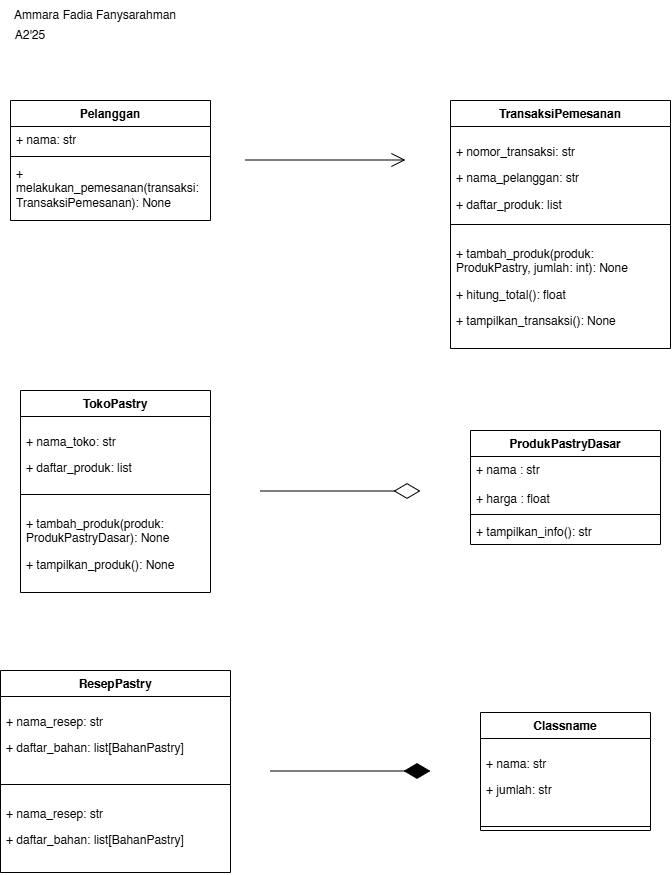

# Sweet Pastry Shop

## 1. Deskripsi Proyek

Sweet Pastry Shop merupakan program berbasis Python yang menerapkan konsep Object-Oriented Programming (OOP) untuk mengelola produk pastry, produk diskon, stok, dan transaksi pemesanan.

Program ini dikembangkan untuk menerapkan konsep abstraksi, inheritance, encapsulation, polymorphism, serta relasi antarkelas yang meliputi association, aggregation, dan composition.

## 2. UML Class Diagram

Berikut merupakan UML Class Diagram yang menggambarkan struktur kelas, atribut, metode, serta hubungan antarkelas dalam program Sweet Pastry Shop.



### Penjelasan Relasi Antarkelas

**a. Association (Asosiasi)**

Relasi asosiasi terjadi antara kelas `Pelanggan` dan `TransaksiPemesanan`. Kelas `Pelanggan` dapat melakukan pemesanan dengan menggunakan objek `TransaksiPemesanan` yang tersedia.

**b. Aggregation (Agregasi)**

Relasi agregasi terjadi antara kelas `TokoPastry` dan `ProdukPastryDasar`. Toko menyimpan kumpulan objek produk yang dibuat secara terpisah. Objek produk tetap dapat digunakan meskipun tidak lagi dimasukkan ke dalam toko.

**c. Composition (Komposisi)**

Relasi komposisi terjadi antara kelas `ResepPastry` dan `BahanPastry`. Kelas `ResepPastry` membuat objek bahan melalui metode `tambah_bahan()` dan menyimpannya dalam daftar bahan resep.

**d. Inheritance (Pewarisan)**

Relasi pewarisan diterapkan pada kelas `ProdukBiasa` dan `ProdukDiskon` yang mewarisi kelas `ProdukPastry`. Selain itu, kelas `MembuatKue` dan `MembuatRoti` mewarisi kelas abstrak `AktivitasPastry`.

## 3. Penerapan Konsep OOP

### 3.1 Abstraction

Abstraksi diterapkan menggunakan modul `abc` melalui kelas abstrak `AktivitasPastry`. Kelas ini memiliki dua abstract method, yaitu `persiapkan()` dan `proses()`, yang wajib diimplementasikan oleh kelas turunannya.

Kelas `MembuatKue` dan `MembuatRoti` mengimplementasikan kedua metode tersebut sesuai dengan aktivitas masing-masing. Kelas `AktivitasPastry` juga memiliki metode konkret `jalankan()` yang dapat digunakan oleh kedua kelas turunannya.

Pengujian dilakukan dengan mencoba membuat objek langsung dari kelas `AktivitasPastry`. Program menghasilkan `TypeError` karena kelas tersebut masih memiliki abstract method yang belum diimplementasikan.

### 3.2 Inheritance

Inheritance diterapkan agar kelas turunan dapat menggunakan atribut dan metode dari kelas induknya. Sebagai contoh, `ProdukBiasa` dan `ProdukDiskon` mewarisi kelas `ProdukPastry`, sedangkan `MembuatKue` dan `MembuatRoti` mewarisi kelas `AktivitasPastry`.

Kelas turunan menggunakan `super().__init__()` untuk memanggil konstruktor kelas induk serta memiliki atribut khusus sesuai fungsinya.

### 3.3 Polymorphism

Polimorfisme diterapkan melalui tiga bentuk berikut:

- **Method overriding:** kelas `MembuatKue` dan `MembuatRoti` memiliki implementasi masing-masing untuk metode `persiapkan()` dan `proses()`.
- **Duck typing:** kelas `LaporanStok` dan `LaporanTransaksi` memiliki metode `tampilkan_ringkasan()` yang dapat dipanggil melalui fungsi `cetak_ringkasan()` tanpa memeriksa jenis kelas objek.
- **Operator overloading:** kelas `BahanPastryUkur` mengimplementasikan metode khusus `__add__()` sehingga dua objek bahan dengan nama yang sama dapat dijumlahkan menggunakan operator `+`.

## 4. Cara Menjalankan Program

1. Pastikan Python sudah terpasang di komputer.
2. Buka folder proyek menggunakan terminal atau Command Prompt.
3. Jalankan perintah berikut:

   ```bash
   python main.py
   ```

4. Amati keluaran program untuk melihat demonstrasi relasi antarkelas, abstraksi, polimorfisme, duck typing, dan operator overloading.

> Catatan: Sesuaikan `main.py` dengan nama file Python utama yang digunakan dalam proyek.

## 5. Dokumentasi Pengujian

Bagian ini berisi bukti berupa tangkapan layar ketika program dijalankan.

### 5.1 Bukti Abstraksi

Pengujian dilakukan dengan mencoba menginstansiasi kelas abstrak `AktivitasPastry`. Program menampilkan pesan bahwa kelas abstrak tidak dapat diinstansiasi dan menghasilkan `TypeError`.


### 5.2 Bukti Polimorfisme Pewarisan

Pengujian menunjukkan bahwa objek `MembuatKue` dan `MembuatRoti` menjalankan metode yang sama dengan implementasi berbeda.


### 5.3 Bukti Duck Typing

Pengujian menunjukkan bahwa objek `LaporanStok` dan `LaporanTransaksi` dapat diproses melalui fungsi `cetak_ringkasan()` karena keduanya memiliki metode `tampilkan_ringkasan()`.


### 5.4 Bukti Operator Overloading

Pengujian menunjukkan penggunaan operator `+` untuk menjumlahkan jumlah bahan pastry melalui metode `__add__()`.


## 6. Kesimpulan

Program Sweet Pastry Shop menerapkan berbagai konsep OOP untuk membentuk struktur program yang modular dan mudah dikembangkan. Penerapan abstraksi, inheritance, dan polimorfisme membantu mengatur perilaku objek, sedangkan association, aggregation, dan composition menggambarkan hubungan antarkelas. Duck typing dan operator overloading juga diterapkan untuk menunjukkan fleksibilitas perilaku objek dalam Python.
